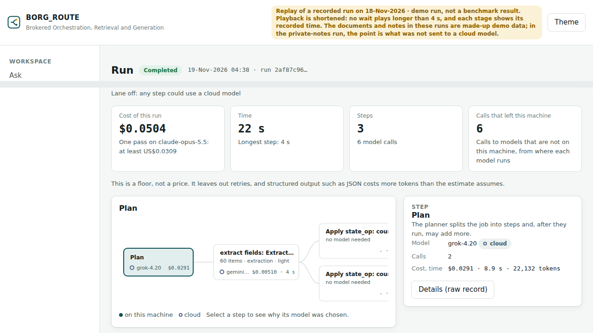

# BORG_ROUTE

Breaks a job into steps and sends each step to the cheapest model that can do it, local or cloud. <!-- claim C01 --> With the private lane on (`raw_local` or `all_local`), the steps that read your documents run only on your own machines. <!-- claim C36 -->



*The Run page after a replay of demo job one, from the CI interface check. The request text in the middle of the page is cut out of the picture. The documents in the demo runs are made up, and a demo run is not a benchmark result.*

## Who it is for

Companies that want AI on their own machines. You run the server, you hold the keys, and you can keep documents on your own hardware (see "The on-premise lane").

## See the demo

You need Docker with the Compose plugin. No key, no `.env` file and no model are needed.

```
docker compose up -d --build
```

Without Docker, with Python installed, from the cloned folder:

```
python -m pip install -c constraints.txt -e .
BORG_DEMO_MODE=replay python -m uvicorn main:app          # Linux, macOS, Git Bash
$env:BORG_DEMO_MODE="replay"; python -m uvicorn main:app  # Windows PowerShell
```

Open `http://localhost:8000`. The default compose service sets replay mode and needs no env file. <!-- claim C27 --> In replay mode the app plays back runs recorded earlier, and no model, key or network call is made. <!-- claim C28 --> Choose a recorded job on the Ask page, watch the steps appear, and read the receipt at the end. Every page says the recorded jobs are made-up demo data and not benchmark results. <!-- claim C35 --> The install guide has the details: `docs/install-guide.md`.

## How it works

1. You send a job through an OpenAI-style chat call, a task call or an MCP tool. <!-- claim C29 --> <!-- claim C33 --> <!-- claim C30 -->
2. A planning model breaks the job into steps. For each step the router picks the ticked model with the lowest effective cost whose score clears the step's floor and whose context fits. The exceptions: the planner names a ticked model, or the run uses `borg_route:local`, which prefers a local model that clears the floor. If no ticked model clears the floor, the step runs on the run's default model and the trace warns BRT-ORC-019. <!-- claim C01 --> <!-- claim C02 --> "Cheapest" means the lowest cost counting both dollars and waiting time, among the models that clear the step's quality floor. A slow local model can lose to a fast cheap cloud model unless the private lane or the local-first setting (`borg_route:local`) is on. The run records why each model was chosen, with up to eight models that cleared the floor. <!-- claim C03 -->
3. Every model call that reports its usage is priced and logged, planner calls included. <!-- claim C04 --> The run total is the sum of the logged calls. <!-- claim C06 --> The operator's own words reach every step, item and call unchanged. <!-- claim C08 -->
4. A short conversational message with no documents is usually answered in one call, without a plan (the Rule Zero shortcut). <!-- claim C34 -->
5. The planning model writes the final answer. A long list in the answer is written by code from the stored rows, in input order. <!-- claim C24 -->

```
job --> planner --> step 1 --> the ticked model with the lowest effective
                \-> step 2 --> cost that clears that step's floor; local and
                \-> step 3 --> cloud models are ranked together
                         \--> final answer + receipt
```

## What was measured

BORG_ROUTE was tested three times against one call to a top model (`anthropic/claude-opus-5.5`) on the same jobs. The rules were written before any run and all three rounds are published as they fell, in `bench/results`. Rounds 1 and 2 won no job. They exposed faults in how the final answer was assembled, and changes were then made; the causes are written up in `docs/design`. Round 3 ran with cloud models only, on fresh data generated from the hash of the frozen code for three of its four jobs; job B reused the earlier input.

Round 3, middle value of three runs unless noted:

| Job | Cost against one call to the top model | Time, BORG_ROUTE against direct | Quality | Verdict by the bench's own rule |
|---|---|---|---|---|
| 200 <!-- claim C37 --> support emails, a category and an urgency score for each | 59.6% <!-- claim C38 --> | 15.8 s <!-- claim C39 --> against 46.9 s <!-- claim C40 --> | category 99% <!-- claim C41 --> right; urgency exact 69.5%, <!-- claim C42 --> within one point 99.5%; <!-- claim C43 --> the top model scored 100% <!-- claim C44 --> on both | no win: the rule asks for accuracy within 2 <!-- claim C45 --> points |
| A small Python service written from a spec (four files) | 54.3% <!-- claim C46 --> by the rule; 98.5% <!-- claim C47 --> if the top model's first, cut-off attempt is left out | 70.2 s <!-- claim C48 --> against 120.3 s <!-- claim C49 --> | all 18 <!-- claim C50 --> checks in two runs, 16 <!-- claim C51 --> in one; the top model passed 18 <!-- claim C52 --> each time | win by the rule; the input was the same as in earlier rounds, so this result is not on fresh data |
| Eight questions and a search for contradictions over 15 <!-- claim C53 --> documents, about 150,000 <!-- claim C54 --> tokens (one run) | 31.6% <!-- claim C55 --> | 22.3 s <!-- claim C56 --> against 9.3 s <!-- claim C57 --> | a judge model preferred the top model's answer | no win |
| A risk label for each of 60 <!-- claim C58 --> short client notes | 87.9% <!-- claim C59 --> | 15.8 s <!-- claim C60 --> against 12.2 s <!-- claim C61 --> | 90% <!-- claim C62 --> right against 100% <!-- claim C63 --> | not judged: this job's rule compares a local model with cloud models, and no local run was made |

By the bench's own rule, then: one win in round 3, on a job whose input was not fresh, and none in rounds 1 and 2. All three rounds side by side: [`bench/results/round_1_vs_round_2.md`](bench/results/round_1_vs_round_2.md).

In round 3 the planning model named the model for every step of the email, code and notes jobs; the router's own rule (the lowest effective cost that clears the floor) chose the two steps of the document job. <!-- claim C103 -->

## Where the cost goes

**Many similar items.** Items go to a low-cost model in packs of 20. <!-- claim C64 --> In round 3 the worker calls for all 200 <!-- claim C37 --> emails cost between US$0.0208 <!-- claim C65 --> and US$0.0402 <!-- claim C66 --> per run. On that job the quality fell outside the bench's rule (see the table above).

**A fixed cost per job.** Planning the job and writing the final answer cost US$0.0739 <!-- claim C67 --> to US$0.1035 <!-- claim C68 --> per run on the email job, 70.8% <!-- claim C69 --> to 83.3% <!-- claim C70 --> of the bill. On a small job, 60 <!-- claim C58 --> short client notes cost about the same as one call to the top model (87.9% <!-- claim C59 --> of it), and the demo run in this repository, 60 <!-- claim C71 --> lines of feedback, cost US$0.0504 <!-- claim C72 --> against at least US$0.0309 <!-- claim C73 --> for one pass.

**Fine judgement on a low-cost model.** Categories were 99% <!-- claim C41 --> right. Urgency, scored from one to five, was one point off on roughly three emails in ten (60 <!-- claim C74 --> of 200, <!-- claim C37 --> the middle value of three runs). The tier floor can be raised to send such steps to a stronger model; that was not measured.

**Questions that compare documents.** On the job with 15 <!-- claim C53 --> documents, which also asks for contradictions between them, a judge preferred the top model's answer.

**Local models.** With the private lane on, the steps that read documents run only on local models; <!-- claim C36 --> a test (`test_a_raw_local_no_canary_reaches_a_cloud_model`) checks that planted canary strings from the documents reach no cloud model; file names, and steps that read only guarded outputs, may still go to a cloud model. <!-- claim C75 --> Cost and speed with a local model were not measured in a round: on the development laptop's CPU the local model produced about 5 <!-- claim C76 --> to 7 <!-- claim C77 --> tokens a second, and a job of 60 <!-- claim C78 --> notes answered 12 <!-- claim C79 --> of 32 <!-- claim C80 --> item calls in about 67 <!-- claim C81 --> minutes and was then stopped. No figure is given for a machine with a GPU.

## Run it for real

1. Copy `.env.example` to `.env` and add your OpenRouter key. **Set `BORG_ADMIN_TOKEN` in `.env`: the live Docker setup needs it.** The browser reaches the container from Docker's gateway address, not from the container's own loopback, so without a token the admin pages and key routes refuse every request.
2. Start the live setup. <!-- claim C31 -->

```
docker compose -f compose.yaml -f compose.live.yaml up -d --build
```

Without Docker, the Python steps are in `docs/install-guide.md`.

3. Open `http://localhost:8000/ui/models.html`, press Discover, tick the models the router may use, press Get Model Info to score them, then ask your first question on the Ask page.

Full steps, settings and troubleshooting: `docs/install-guide.md`. How each page and setting behaves: `docs/user-guide.md`.

## The on-premise lane

The lane is off by default. Its promise depends on the mode.

- `raw_local` and `all_local` keep your documents on your own machines. The promise, in the user guide's words: raw document text is sent only to models on your own machines, and everything sent to a cloud model is listed and you can read it. <!-- claim C11 -->
- In `all_local`, nothing is sent off the machine. <!-- claim C12 -->
- A step that must stay local never falls back to a cloud model. <!-- claim C13 -->
- Every request is recorded before it is sent, and a failed record blocks the send. <!-- claim C14 -->
- In `raw_local` and `all_local`, what a local step returns is checked, and an output that copies document text is withheld. <!-- claim C17 -->
- `by_reference` makes no privacy promise. Cloud models can read the documents, and the output check and the check on outgoing requests (BRT-LANE-006) do not run. See "On-premise lane" in `docs/user-guide.md`.

Read "What is not promised" in the user guide before you rely on the lane.

## Limits

- A reply cut off by the token cap is retried once with a larger cap, then fails. <!-- claim C22 -->
- If every planned step fails and the planning model still writes an answer, the receipt says so in plain words. Treat that answer as unchecked. <!-- claim C26 -->
- Admin pages and keys are locked by `BORG_ADMIN_TOKEN`. Without a token, only the machine itself may use them, which in Docker is nobody, so the live Docker setup needs a token. Running `uvicorn` directly on the host is the one case where the loopback rule works without one. <!-- claim C18 -->
- The replay demo cannot change anything: every route that changes state is refused. <!-- claim C28 -->

## Related projects

- [The_Borg_DB](https://github.com/D-jai/The_Borg_DB-public): a local-first knowledge base that turns your meetings, emails and documents into searchable facts and mines them for patterns.
- [openclaw-openwebui-pipe](https://github.com/D-jai/openclaw-openwebui-pipe): connects Open WebUI's chat to an OpenClaw agent.

## Licence

MIT. See `LICENSE`.

## Contact

Dhananjay Raol, Aliud Inquisito Inc. Questions and problems: open an issue at https://github.com/D-jai/Borg_Routing/issues.
